# КТ-10 - Регистрация и управление пользователями

Студент - Денисенко Даниил Евгеньевич  
Группа - 4п4.23 NET  
Дисциплина - ADO.NET  

### Задания

**Задание 1. Веб-форма регистрации пользователей**

Цель: разработать веб-форму с серверной валидацией для регистрации пользователей.

Задачи:

1. Создайте веб-форму с полями:
   - Имя пользователя (не менее 3 символов, только буквы)
   - Электронная почта (должна содержать @ и .)
   - Пароль (не менее 8 символов, должен содержать цифры и буквы)
   - Подтверждение пароля (должно совпадать с полем пароля)
2. При отправке формы данные должны проходить валидацию на сервере.
3. При успешной валидации пользователь добавляется в базу данных (имитация через сохранение в файл или использование in-memory базы данных).
4. Пользователю отображается сообщение об успешной регистрации или об ошибках валидации.

**Задание 2. Разработка RESTful API для управления данными пользователя**

Цель: создать RESTful API, которое позволит получать, добавлять, обновлять и удалять информацию о пользователях.

Задачи:

1. Создать API, какое должно поддерживать следующие операции:

- GET для получения списка всех пользователей
- GET (с ID) для получения конкретного пользователя
- POST для добавления нового пользователя
- PUT (с ID) для обновления данных пользователя
- DELETE (с ID) для удаления пользователя

2. Данные должны храниться в in-memory базе данных.

3. Для каждого запроса необходимо реализовать валидацию данных.

4. Предусмотреть обработку ошибок, включая несуществующие ID пользователей.

### Задание 1

Добавил форму регистрации с проверкой имени, почты, пароля и его подтверждения на сервере
При успешной проверке пользователь сохраняется в базе в памяти, пароль хранится как хеш

Главная страница с переходами к двум заданиям

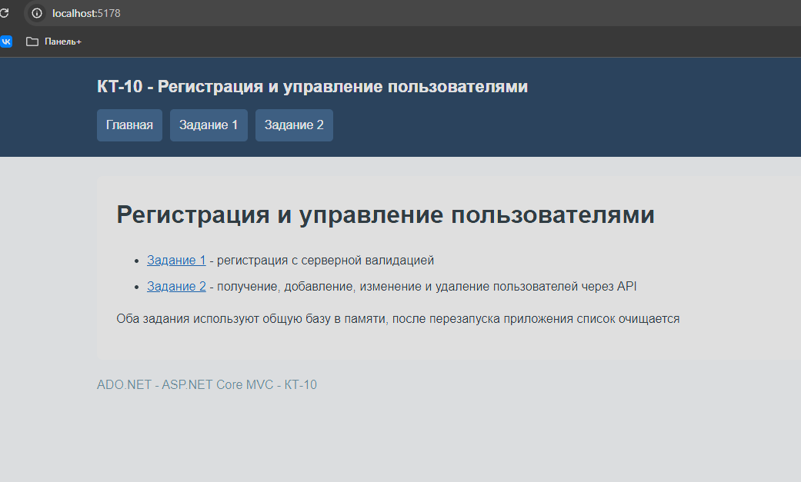

Форма регистрации с именем пользователя, почтой, паролем и подтверждением

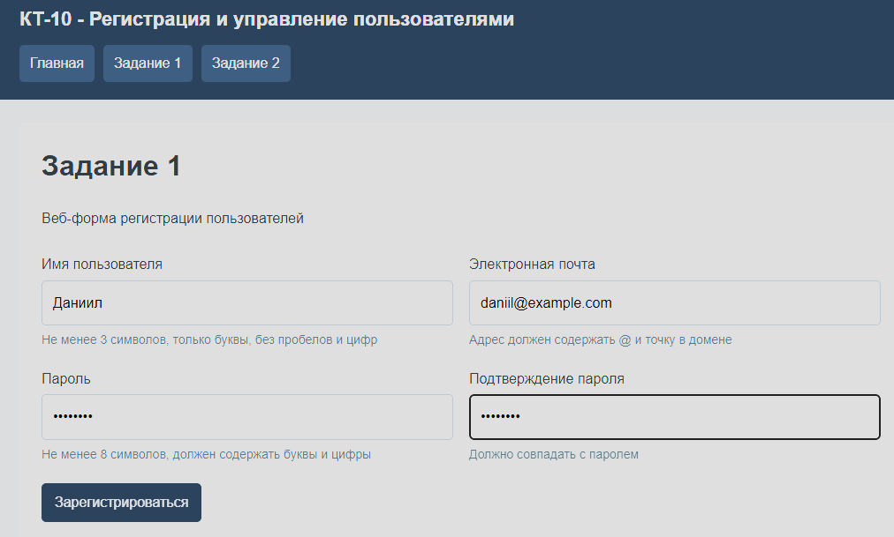

Сообщение об успешной регистрации и данные добавленного пользователя

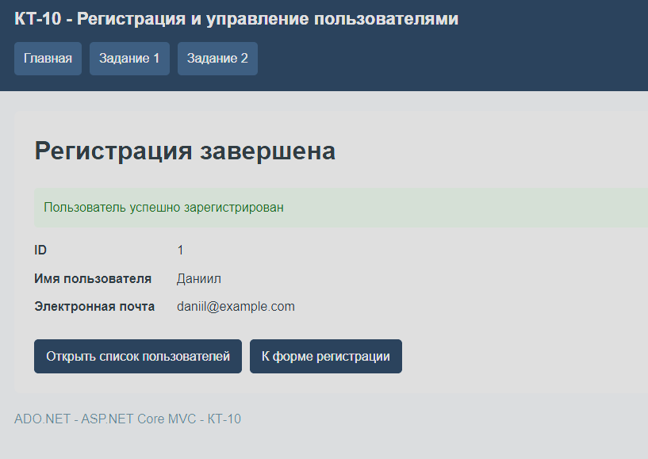

Ошибки серверной проверки имени, почты, пароля и подтверждения

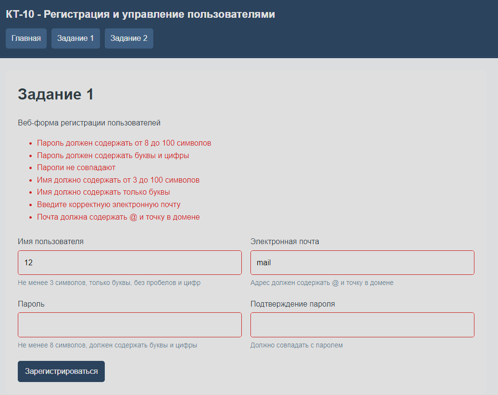

### Задание 2

Добавил API для получения списка и отдельного пользователя, добавления, изменения и удаления
API и форма регистрации используют одну базу EF Core InMemory
Неверные данные возвращают статус 400, отсутствующий пользователь 404, повторное имя или почта 409

Получение списка, зарегистрированный пользователь доступен через API

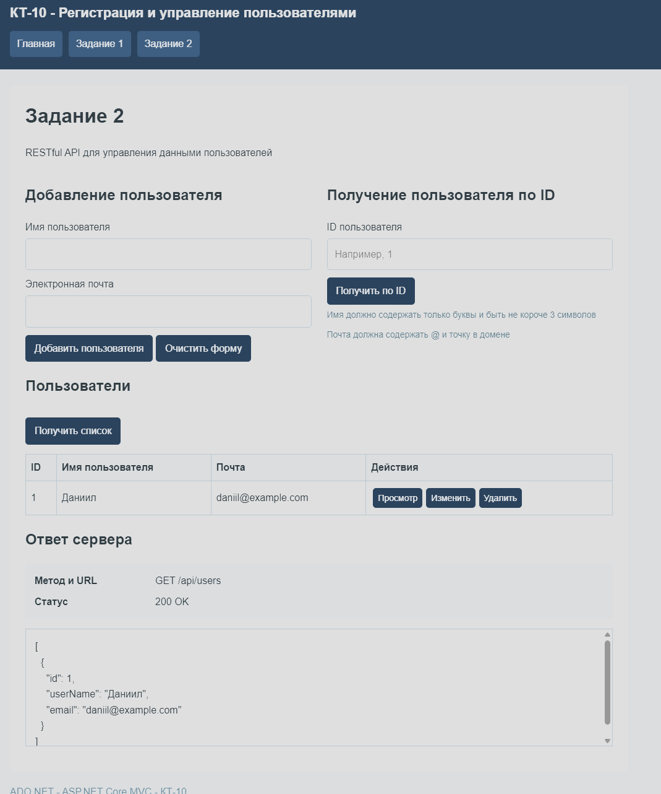

Добавление пользователя через POST, статус 201

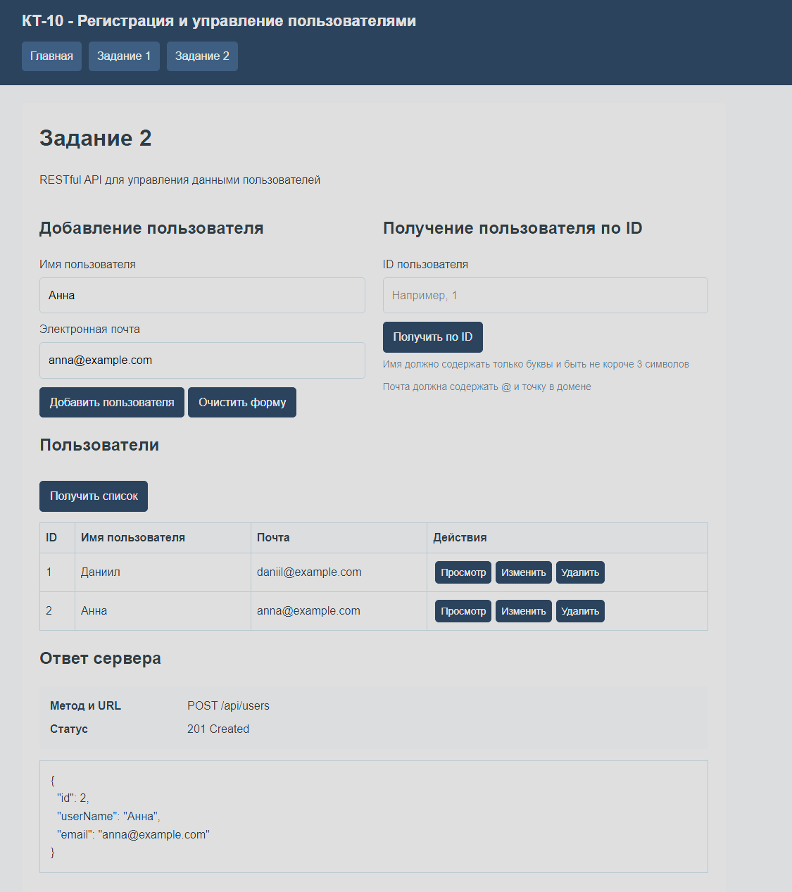

Получение отдельного пользователя по ID, статус 200

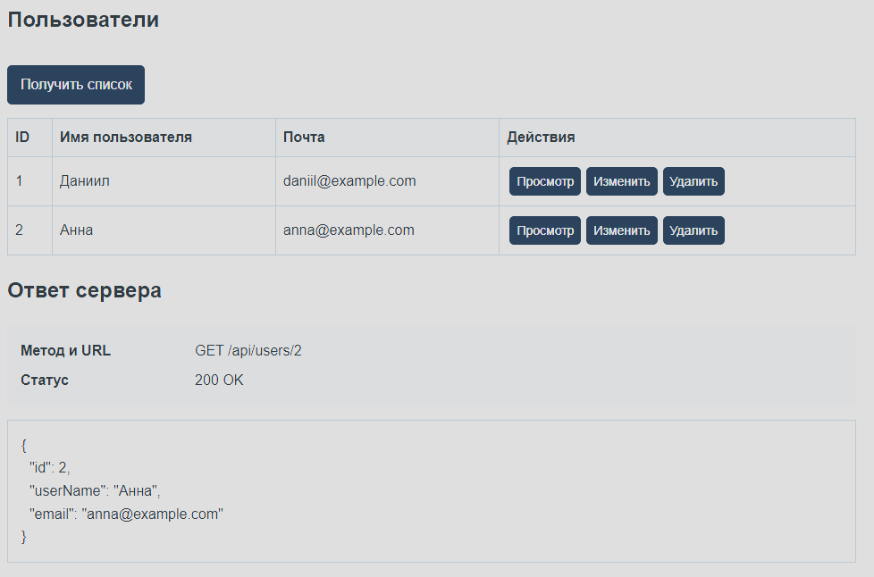

Изменение имени и почты через PUT, новые данные отображаются в ответе и списке

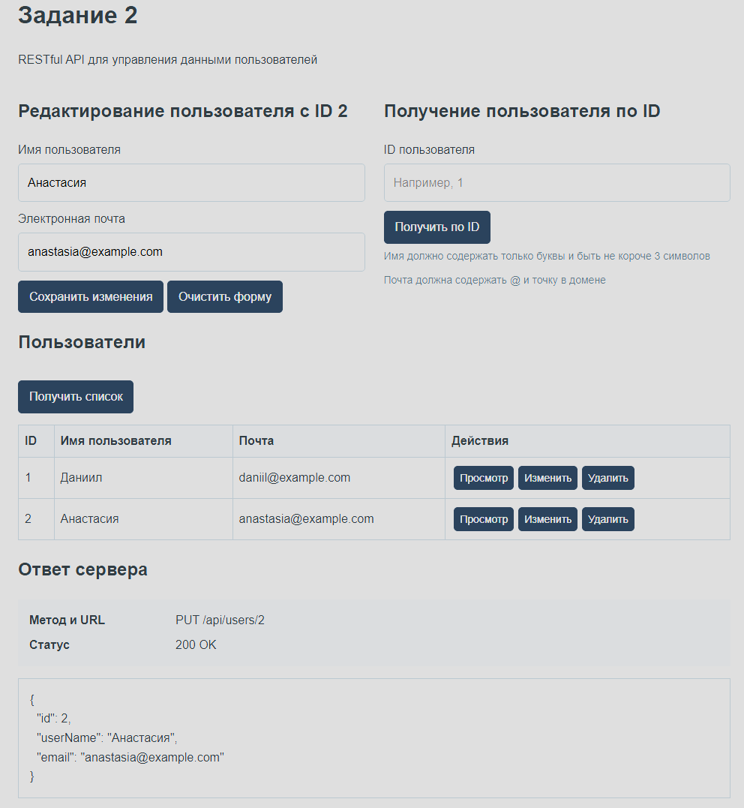

Удаление пользователя через DELETE, статус 204

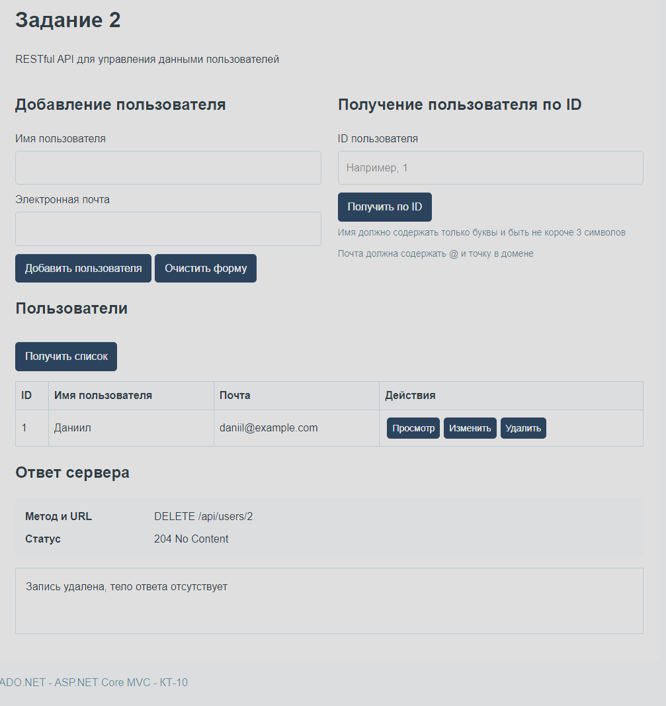

Запрос пользователя с несуществующим ID возвращает статус 404 и сообщение об ошибке

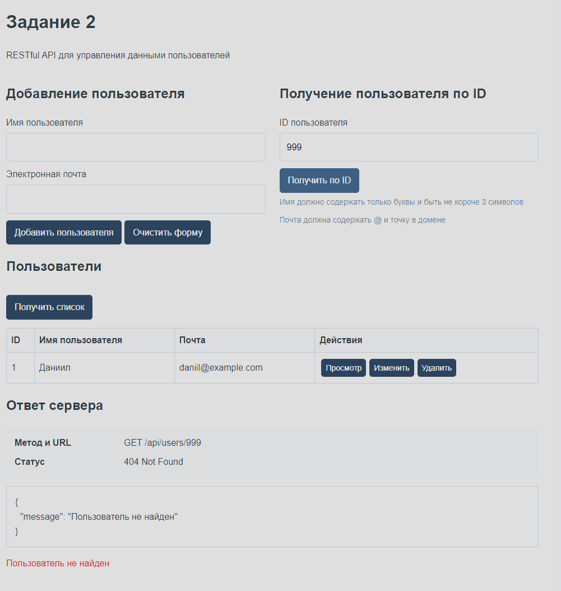

Неверные имя и почта возвращают статус 400 с описанием ошибок

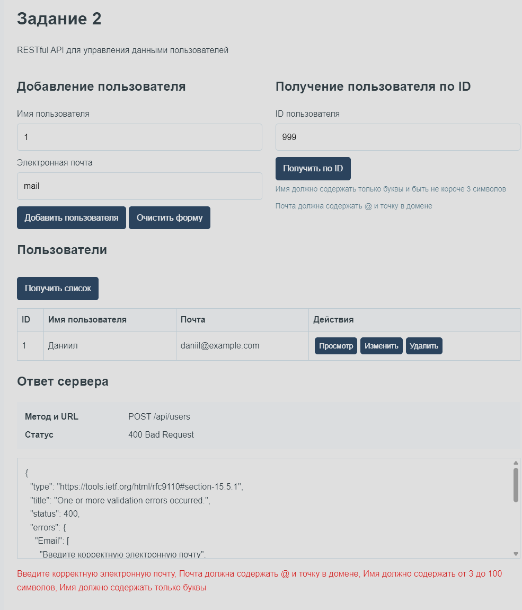

Повторное имя пользователя возвращает статус 409, новая запись не добавляется

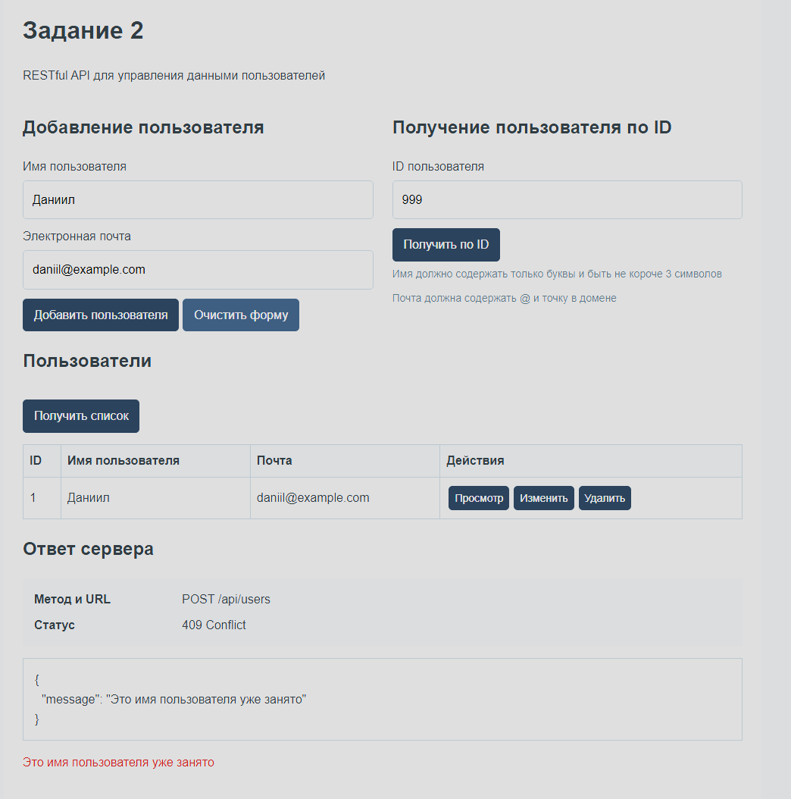
